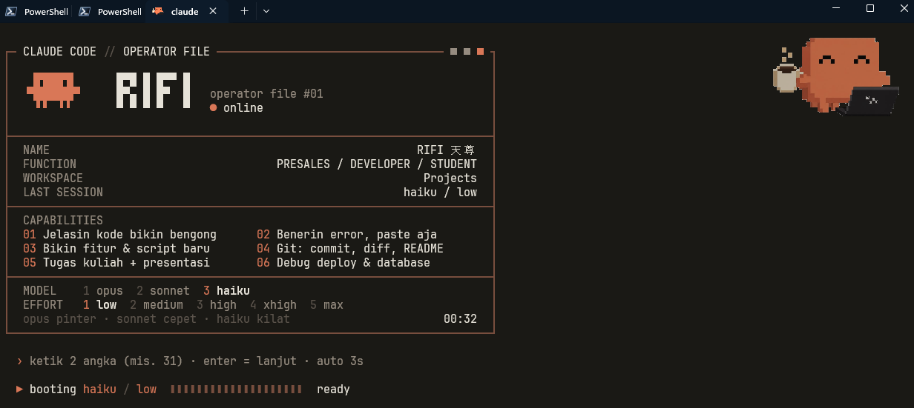
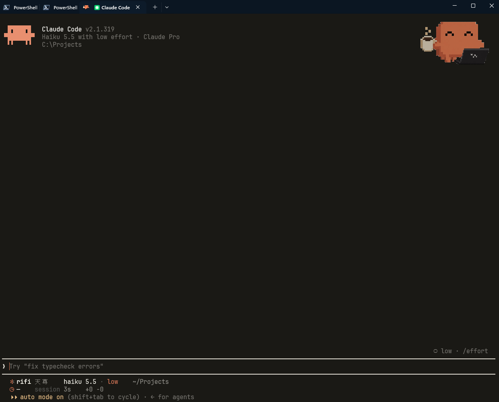

# Ember

Ember adalah lapisan tampilan untuk Claude Code di Windows Terminal. Namanya saya ambil dari bara api, warna oranye hangat yang jadi ciri khas Claude, dan dari ide bahwa sebuah AI agent sebaiknya terasa seperti bara yang tenang, selalu menyala di sudut layar dan siap dipakai kapan saja tanpa perlu berisik. Proyek ini lahir setelah Shell Senpai. Awalnya saya cuma ingin mencoba Claude Code di Windows, tapi setelah beberapa menit memakainya saya merasa tampilannya terlalu polos untuk sesuatu yang bakal saya buka setiap hari. Jadilah saya mendandaninya pelan pelan, dengan kartu identitas bergaya HUD, daftar kemampuan, dan pemilihan model sebelum masuk ke sesi.

Repo ini berisi semua script dan konfigurasi yang saya pakai untuk membungkus Claude Code di Windows Terminal. Semuanya disimpan di sini supaya kalau laptop harus diinstal ulang, saya cukup clone repo ini, jalankan satu installer, dan tampilannya langsung kembali seperti semula.

## Preview

Tangkapan layar pertama adalah layar operator file yang muncul setiap kali perintah claude dijalankan, tempat memilih model dan effort sebelum sesi dimulai.



Tangkapan layar kedua adalah tampilan di dalam Claude Code, dengan palet warna Claude, status bar dua baris, dan maskot yang sedang ngopi di pojok kanan atas.



## Tentang Proyek Ini

Ember bukan aplikasi baru, melainkan lapisan tipis di atas Claude Code. Perintah claude saya bungkus dengan fungsi PowerShell yang membuka tab khusus di Windows Terminal. Tab ini punya color scheme sendiri bernama Claude Dark, jadi tab PowerShell biasa tetap memakai Ocean Deep dari Shell Senpai. Sebelum Claude Code jalan, rifi-launcher.ps1 menggambar layar operator file dan menunggu pilihan model serta effort. Setelah itu palet ANSI terminal diganti sementara ke warna Claude, lalu dikembalikan lagi saat sesi ditutup.

Prinsip yang saya pegang masih sama seperti di Shell Senpai, yaitu tampilan keren tidak boleh bikin mata capek. Saya sempat mencoba efek CRT dan glow neon, tapi setelah satu jam rasanya pusing. Akhirnya garis border dibuat oranye redup, warna terang hanya dipakai untuk aksen kecil seperti nomor dan titik status, dan background dibuat hitam kecoklatan supaya nyambung dengan warna hangat Claude.

## Fitur Unggulan

| Fitur | Penjelasan |
|---|---|
| Layar Operator File | Kartu identitas bergaya HUD retro berisi nama, fungsi, workspace, branch Git, dan sesi terakhir |
| Logo dan Nama Pixel | Logo Claude dan tulisan RIFI 天尊 dari karakter blok di bagian atas kartu |
| Loadout Satu Langkah | Model dan effort dipilih dengan dua angka, misalnya 31 untuk haiku dan low |
| Auto Lanjut | Kalau tidak ada input selama tiga detik, sesi langsung jalan dengan pilihan terakhir |
| Palet Claude | Warna ANSI diganti ke palet Claude selama sesi, termasuk layar trust folder dan tombol pilihan |
| Tab Khusus | Profile Claude Code di Windows Terminal dengan scheme Claude Dark dan maskot di pojok kanan atas |
| Status Bar Dua Baris | Nama, model, effort, folder, dan branch di baris pertama, lalu waktu respons, durasi sesi, dan baris kode berubah di baris kedua |
| Timer Respons | Lama Claude menjawab prompt terakhir dihitung lewat hook, jadi kelihatan model mana yang lebih cepat |
| Info Context | Bar titik yang menunjukkan seberapa penuh context, kalau versi Claude Code mengirimkan datanya |
| Gaya Bahasa Jaksel | Claude ngobrol santai pakai gue lo, dan otomatis pindah ke bahasa baku kalau diminta formal |

## Struktur Repo

Folder scripts berisi tiga file. Ada rifi-launcher.ps1 sebagai mesin layar operator file dan pemilih loadout, statusline.ps1 yang menggambar status bar di dalam Claude Code, dan rifi-timer.ps1 yang mencatat waktu mulai dan selesai setiap prompt. Folder assets menyimpan gambar maskot yang dipakai sebagai background tab. File CLAUDE.md berisi aturan gaya bahasa, sedangkan install.ps1 mengurus semua pemasangan dalam sekali jalan.

## Instalasi

Bagian ini sengaja saya tulis dari nol, mulai dari laptop yang belum terpasang apa apa, karena waktu pertama kali mencoba saya sendiri sempat bingung harus mulai dari mana. Semua langkah dijalankan lewat terminal, jadi siapkan kopi dulu.

### 1. Siapkan Terminal dan Tools Dasar

Buka Windows PowerShell bawaan, cukup sebagai user biasa dan tidak perlu Run as Administrator, lalu pasang Windows Terminal, PowerShell 7, Git, dan font JetBrains Mono Nerd Font lewat winget. Setelah selesai, tutup PowerShell bawaan dan mulai sekarang pakai Windows Terminal dengan profile PowerShell 7.

```powershell
'Microsoft.WindowsTerminal','Microsoft.PowerShell','Git.Git','DEVCOM.JetBrainsMonoNerdFont','GitHub.cli' | ForEach-Object { winget install --id $_ -e --accept-source-agreements --accept-package-agreements }
```

Kalau nanti muncul pesan bahwa script tidak diizinkan berjalan, izinkan script lokal untuk user kamu sendiri dengan perintah berikut.

```powershell
Set-ExecutionPolicy -Scope CurrentUser RemoteSigned -Force
```

### 2. Pasang Claude Code

Claude Code adalah AI coding agent dari Anthropic yang berjalan langsung di terminal. Kamu cukup bicara pakai bahasa sehari hari, lalu dia membaca isi project, mengedit file, dan menjalankan perintah untukmu. Untuk memakainya kamu butuh akun Claude berbayar seperti Pro atau Max, atau API key dari Console. Pemasangannya cukup satu baris dan tidak butuh Node.js.

```powershell
irm https://claude.ai/install.ps1 | iex
```

Di laptop saya, installer sempat memberi peringatan bahwa folder .local\bin belum masuk PATH, sehingga perintah claude tidak dikenali. Kalau kamu mengalami hal yang sama, tambahkan foldernya ke PATH lewat perintah di bawah ini lalu cek versinya.

```powershell
$bin = "$env:USERPROFILE\.local\bin"
$userPath = [Environment]::GetEnvironmentVariable("Path", "User")
if ($userPath -notlike "*$bin*") { [Environment]::SetEnvironmentVariable("Path", "$userPath;$bin", "User") }
$env:Path = [Environment]::GetEnvironmentVariable("Path","Machine") + ";" + [Environment]::GetEnvironmentVariable("Path","User")
claude --version
```

### 3. Login dan Cek Kesehatan

Login ke akun Claude kamu. Browser akan terbuka otomatis, dan kalau tidak, salin saja link yang muncul di terminal. Setelah itu jalankan claude doctor. Kalau di bagian bawah tertulis No installation issues found, berarti Claude Code sudah siap dipakai.

```powershell
claude auth login
claude doctor
```

### 4. Pasang Ember

Sekarang clone repo ini dan jalankan installer-nya. Installer akan menyalin script ke folder .claude, mendaftarkan status bar dan hook timer ke pengaturan Claude Code, menambahkan scheme Claude Dark serta profile Claude Code ke Windows Terminal, lalu memasang fungsi claude di profile PowerShell. Pengaturan Windows Terminal yang lama otomatis dicadangkan sebagai settings.json.bak.

```powershell
git clone https://github.com/NullIvy/ember.git
cd ember
pwsh -File .\install.ps1
```

### 5. Sentuhan Terakhir

Supaya huruf 天尊 tidak berubah jadi kotak, tambahkan font cadangan yang punya karakter CJK. Buka Settings di Windows Terminal, pilih Open JSON file, lalu di bagian profiles.defaults ubah nama font menjadi seperti ini.

```json
"font": { "face": "JetBrainsMono Nerd Font, MS Gothic" }
```

Setelah itu tutup semua jendela Windows Terminal, buka lagi, masuk ke folder project, lalu jalankan claude. Saat pertama masuk sesi, ketik /theme lalu pilih tema dark dengan warna ANSI supaya palet Claude terpakai di seluruh tampilan. Langkah ini cukup dilakukan sekali.

```powershell
mkdir C:\Projects -Force; cd C:\Projects
claude
```

### Kalau Ada Masalah

Beberapa masalah yang sempat saya temui sendiri, siapa tahu kamu juga mengalaminya. Kalau perintah claude tidak dikenali, berarti PATH belum diperbarui, jadi ulangi langkah 2 lalu buka ulang terminal. Kalau status bar tidak muncul atau isinya tanda tanya, pastikan PowerShell 7 terpasang karena script status bar dijalankan lewat pwsh. Kalau angka timer masih berupa strip, kirim satu prompt dulu, karena timer baru terisi setelah Claude selesai menjawab. Terakhir, hindari menjalankan Claude Code di folder home atau sebagai Administrator, karena Claude bisa membaca dan mengedit semua file di folder tempat dia dibuka. Biasakan selalu masuk ke folder project terlebih dulu.

## Cara Pakai

Perintah claude membuka tab baru di folder yang sedang aktif, menampilkan layar operator file, lalu menunggu dua angka. Angka pertama adalah model, yaitu 1 untuk opus, 2 untuk sonnet, dan 3 untuk haiku. Angka kedua adalah effort dari 1 untuk low sampai 5 untuk max. Tekan Enter saja kalau mau memakai pilihan terakhir. Perintah lain seperti claude doctor atau claude -p tetap berjalan normal tanpa layar pembuka. Saran saya, selalu masuk ke folder project dulu sebelum menjalankan claude, karena Claude hanya bisa melihat folder tempat dia dibuka.

## Kustomisasi

Isi kartu operator file bisa diganti sesuka hati. Nama dan fungsi ada di baris kv di dalam rifi-launcher.ps1, sedangkan daftar kemampuan ada di variabel $it. Gaya bahasa Claude bisa diubah lewat file CLAUDE.md di folder .claude. Posisi dan transparansi maskot diatur dari profile Claude Code di pengaturan Windows Terminal, dan kalau ingin memakai maskot sendiri cukup ganti file claude-mascot-pad.png dengan gambar PNG transparan pilihanmu.

## Penutup

Proyek ini lahir dari banyak trial and error, mulai dari garis border yang meleset satu kolom, huruf 天尊 yang menolak muncul, sampai angka aneh yang nyelip di depan nama karena PowerShell tidak membedakan huruf besar dan kecil di nama variabel. Semua itu justru membuat saya belajar bahwa tampilan yang enak dipakai lahir dari detail kecil yang dibenerin satu per satu. Kalau kamu menemukan bug atau punya ide untuk membuatnya lebih seru, silakan buka issue atau kirim pull request, karena main bareng party selalu lebih asyik daripada solo queue.

Claude dan Claude Code adalah merek dagang milik Anthropic, dan proyek ini adalah proyek fan yang tidak resmi.

Dibuat dengan secangkir kopi dan terlalu banyak kali mengetik claude oleh NullIvy. GG and have fun.
